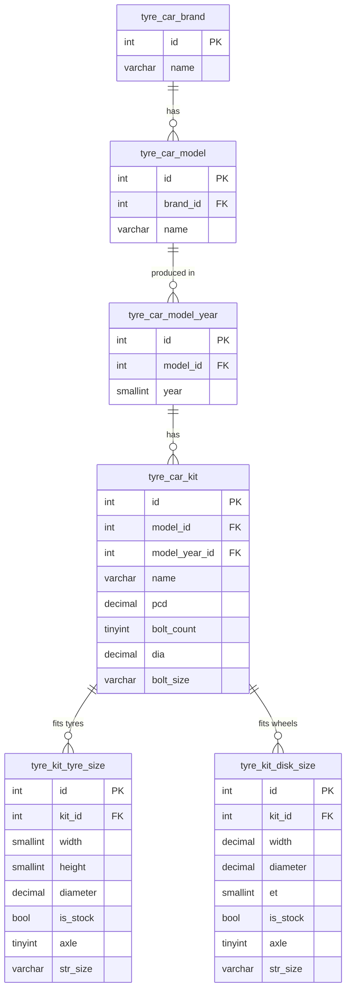

# 🚗 Tire & Wheel Fitment Database — Free SQL / CSV Sample (Car Tyre Size & Rim Size by Vehicle)

[](https://fitment-api.com/en?utm_source=github&utm_medium=readme&utm_campaign=tyre_demo&utm_content=badge)


**Free demo of a vehicle tire and wheel fitment database**: car make → model → year → modification (trim / engine) → **OEM and alternative tyre sizes**, **rim sizes**, **bolt pattern (PCD)**, **center bore (DIA / CB)**, **offset (ET)** and **lug nut / bolt thread size**.

Ready-to-import **MySQL dump (`.sql`)** and **CSV** files — perfect for tire shops, wheel e‑commerce stores, "search tires by car" filters, fitment guides, mobile apps and auto parts marketplaces.

> ### 👉 This repository is a **free sample**. The complete, regularly updated tire & wheel fitment database for **all car brands** is available at **[fitment-api.com](https://fitment-api.com/en?utm_source=github&utm_medium=readme&utm_campaign=tyre_demo&utm_content=top_cta)** — as a downloadable SQL/CSV database or via REST API.

---

## 📑 Table of Contents

- [What's in the demo](#-whats-in-the-demo)
- [Use cases](#-use-cases)
- [Files](#-files)
- [Database schema](#-database-schema)
- [Quick start: import into MySQL](#-quick-start-import-into-mysql)
- [Example SQL queries](#-example-sql-queries)
- [Demo vs Full database](#-demo-vs-full-database)
- [FAQ](#-faq)
- [Get the full database / API](#-get-the-full-tire--wheel-fitment-database)

---

## 📦 What's in the demo

| Data | Rows in sample |
|---|---|
| Car brands (makes) | **7** — Alfa Romeo, Audi, Beiqi, Bentley, BYD, Cadillac, Citroën |
| Car models | **322** |
| Model years | **3,142** (from **1953 to 2026**) |
| Modifications / trims (engine, body, generation) | **21,501** |
| Wheel (rim) sizes — OEM + aftermarket | **93,544** |
| Tyre sizes — OEM + replacement | **93,346** |

For every vehicle modification you get:

- 🛞 **Tire sizes** — stock (factory / OEM) and alternative (plus‑size) options, e.g. `205/55 R16`
- ⚙️ **Wheel / rim sizes** — width × diameter, offset, e.g. `6.5x16 5x112 ET46 DIA57.1`
- 🔩 **Bolt pattern (PCD)** — e.g. `5x112`, `4x98`, `5x114.3`
- ⭕ **Center bore / hub bore (DIA)** — e.g. `57.1`, `66.6`
- 🔧 **Lug bolt / nut thread size** — e.g. `M14 x 1.5`
- ↔️ **Front / rear axle staggered fitment** (different sizes on front and rear axle)

---

## 💡 Use cases

- **Tire & wheel online stores** — "Find tires by vehicle" / "Shop wheels by car" filter (Year → Make → Model → Trim)
- **WooCommerce, Shopify, Magento, OpenCart, PrestaShop** product filters and fitment widgets
- **Tire shops & service stations** — quickly look up the correct tyre size for a customer's car
- **Wheel configurators** and rim visualizers
- **Auto parts marketplaces & catalogs** — fitment compatibility (ACES‑style vehicle lookup)
- **Mobile apps** — tire pressure / tire size / wheel guide apps
- **Data analysis & machine learning** on automotive data

---

## 📁 Files

Every table is provided in two formats: **`.sql`** (`CREATE TABLE` + `INSERT`) and **`.csv`** (comma‑separated, with header row).

| File | Description |
|---|---|
| [`tyre_car_brand`](tyre_car_brand.csv) | Car makes (brands) |
| [`tyre_car_model`](tyre_car_model.csv) | Car models, linked to brand |
| [`tyre_car_model_year`](tyre_car_model_year.csv) | Production years per model |
| [`tyre_car_kit`](tyre_car_kit.csv) | Modifications / trims: PCD, bolt count, center bore, bolt size |
| [`tyre_kit_tyre_size`](tyre_kit_tyre_size.csv) | Tyre sizes per modification (stock + alternative, by axle) |
| [`tyre_kit_disk_size`](tyre_kit_disk_size.csv) | Wheel / rim sizes per modification (stock + alternative, by axle) |
| [`all_tires`](all_tires.csv) | 🔥 **Denormalized flat view** — everything in one row: brand, model, year, modification, tire sizes, rim sizes, PCD, DIA, bolt size |

> 💡 Just want to look at the data? Open **[`all_tires.csv`](all_tires.csv)** — GitHub renders it as a searchable table.

---

## 🗂 Database schema



**Field reference**

| Field | Meaning |
|---|---|
| `pcd` | Pitch circle diameter, mm (e.g. `112.00`) |
| `bolt_count` | Number of lug bolts / studs (e.g. `5`) |
| `dia` | Center bore (hub bore) diameter, mm |
| `bolt_size` | Lug bolt / nut thread (e.g. `M12 x 1.25`) |
| `et` | Wheel offset, mm |
| `is_stock` | `1` = factory OEM size, `0` = alternative / replacement size |
| `axle` | `0` = both axles, `1` = front axle, `2` = rear axle (staggered setup) |
| `axle_group` | Groups front + rear sizes that belong to the same staggered set |
| `str_size` | Human‑readable size string (`205/55 R16`, `7x17 5x112 ET45 DIA57.1`) |

---

## 🚀 Quick start: import into MySQL

```bash
git clone https://github.com/bogdan281989/tyre_wheels_sql_database.git
cd tyre_wheels_sql_database

mysql -u root -p -e "CREATE DATABASE fitment CHARACTER SET utf8mb4 COLLATE utf8mb4_unicode_ci;"

# import in dependency order (foreign keys)
for t in tyre_car_brand tyre_car_model tyre_car_model_year tyre_car_kit tyre_kit_tyre_size tyre_kit_disk_size; do
  mysql -u root -p fitment < "$t.sql"
done
```

Works with **MySQL 5.7+ / 8.x** and **MariaDB**. CSV files can be imported into **PostgreSQL, SQLite, SQL Server, Excel, Google Sheets, pandas**, etc.

---

## 🧪 Example SQL queries

**Find stock tire sizes for a car (make / model / year):**

```sql
SELECT b.name AS brand, m.name AS model, k.year, k.name AS modification,
       t.str_size AS tyre_size, t.is_stock
FROM tyre_car_kit k
JOIN tyre_car_model m ON m.id = k.model_id
JOIN tyre_car_brand b ON b.id = m.brand_id
JOIN tyre_kit_tyre_size t ON t.kit_id = k.id
WHERE b.name = 'Audi' AND m.name = 'A4' AND k.year = 2018
ORDER BY k.name, t.is_stock DESC, t.diameter;
```

**Which cars fit tyre size 225/45 R17?**

```sql
SELECT DISTINCT b.name AS brand, m.name AS model, k.year, k.name AS modification
FROM tyre_kit_tyre_size t
JOIN tyre_car_kit k ON k.id = t.kit_id
JOIN tyre_car_model m ON m.id = k.model_id
JOIN tyre_car_brand b ON b.id = m.brand_id
WHERE t.width = 225 AND t.height = 45 AND t.diameter = 17;
```

**Find all vehicles with bolt pattern 5x112 and center bore 57.1:**

```sql
SELECT b.name, m.name, k.year, k.name
FROM tyre_car_kit k
JOIN tyre_car_model m ON m.id = k.model_id
JOIN tyre_car_brand b ON b.id = m.brand_id
WHERE k.bolt_count = 5 AND k.pcd = 112 AND k.dia = 57.1;
```

**Wheel (rim) sizes for a modification, front/rear:**

```sql
SELECT str_size, is_stock, axle
FROM tyre_kit_disk_size
WHERE kit_id = 641
ORDER BY is_stock DESC, diameter, width;
```

---

## ⚖️ Demo vs Full database

| | **Demo (this repo)** | **[Full database](https://fitment-api.com/en?utm_source=github&utm_medium=readme&utm_campaign=tyre_demo&utm_content=compare_table)** |
|---|:---:|:---:|
| Car brands | 7 | ✅ All brands worldwide |
| Models, years, modifications | Only for 7 brands | ✅ Complete coverage |
| Tyre & wheel sizes (OEM + alternative) | ✅ | ✅ |
| PCD, center bore, offset, bolt size | ✅ | ✅ |
| Regular updates (new models & years) | ❌ | ✅ |
| REST API access | ❌ | ✅ |
| Commercial use | ❌ | ✅ |
| Technical support | ❌ | ✅ |

<p align="center">
  <a href="https://fitment-api.com/en?utm_source=github&utm_medium=readme&utm_campaign=tyre_demo&utm_content=big_button">
    
  </a>
</p>

---

## ❓ FAQ

<details>
<summary><b>What is a tire and wheel fitment database?</b></summary>

It's a structured dataset that tells you which tire sizes and wheel (rim) sizes fit a specific vehicle — by make, model, year and modification — including bolt pattern (PCD), center bore, offset and lug thread. Online stores use it to build "search by vehicle" filters and avoid returns caused by wrong sizes.
</details>

<details>
<summary><b>Is this data free?</b></summary>

This repository contains a free **sample** for evaluation and testing (7 brands). The complete database with all car makes is available at [fitment-api.com](https://fitment-api.com/en?utm_source=github&utm_medium=readme&utm_campaign=tyre_demo&utm_content=faq).
</details>

<details>
<summary><b>What formats are available?</b></summary>

MySQL / MariaDB SQL dump and CSV. The full version is also available via REST API (JSON).
</details>

<details>
<summary><b>Does it include OEM (factory) and alternative (plus-size) tire sizes?</b></summary>

Yes. Every size has an `is_stock` flag: `1` — OEM factory size, `0` — approved alternative / replacement size.
</details>

<details>
<summary><b>Does it support staggered fitment (different front and rear sizes)?</b></summary>

Yes. The `axle` field (`0` both, `1` front, `2` rear) and `axle_group` describe staggered setups.
</details>

<details>
<summary><b>Can I use it with WooCommerce, Shopify, OpenCart or Magento?</b></summary>

Yes. The data is platform‑agnostic — import the SQL/CSV into your store or connect via API to build a Year / Make / Model / Trim tire & wheel finder.
</details>

---

## 🛒 Get the full tire & wheel fitment database

Need **all car makes and models**, regular updates, API access and a commercial license?

### ➡️ **[https://fitment-api.com/en](https://fitment-api.com/en?utm_source=github&utm_medium=readme&utm_campaign=tyre_demo&utm_content=footer)**

⭐ If this sample is useful, please **star the repository** — it helps others find it!

---

<sub>**Keywords:** tire fitment database, wheel fitment database, tyre size database, rim size by car, vehicle tire size data, car wheel specs, bolt pattern database, PCD database, center bore database, wheel offset ET, lug nut thread size, OEM tire sizes, year make model trim database, tire size by vehicle SQL, wheel fitment API, tyre and wheel CSV, MySQL car database, automotive dataset, tire shop database, wheel guide, car tyre data, база шин і дисків, підбір шин по авто, подбор шин и дисков по марке авто, база типоразмеров шин.</sub>
